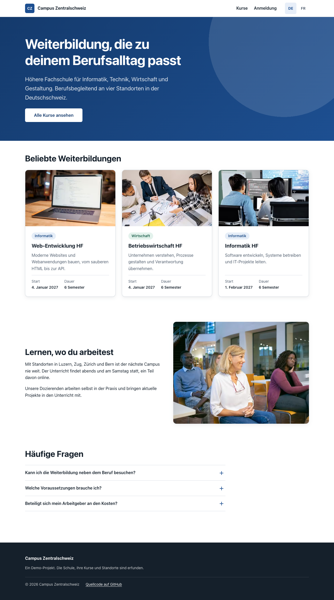
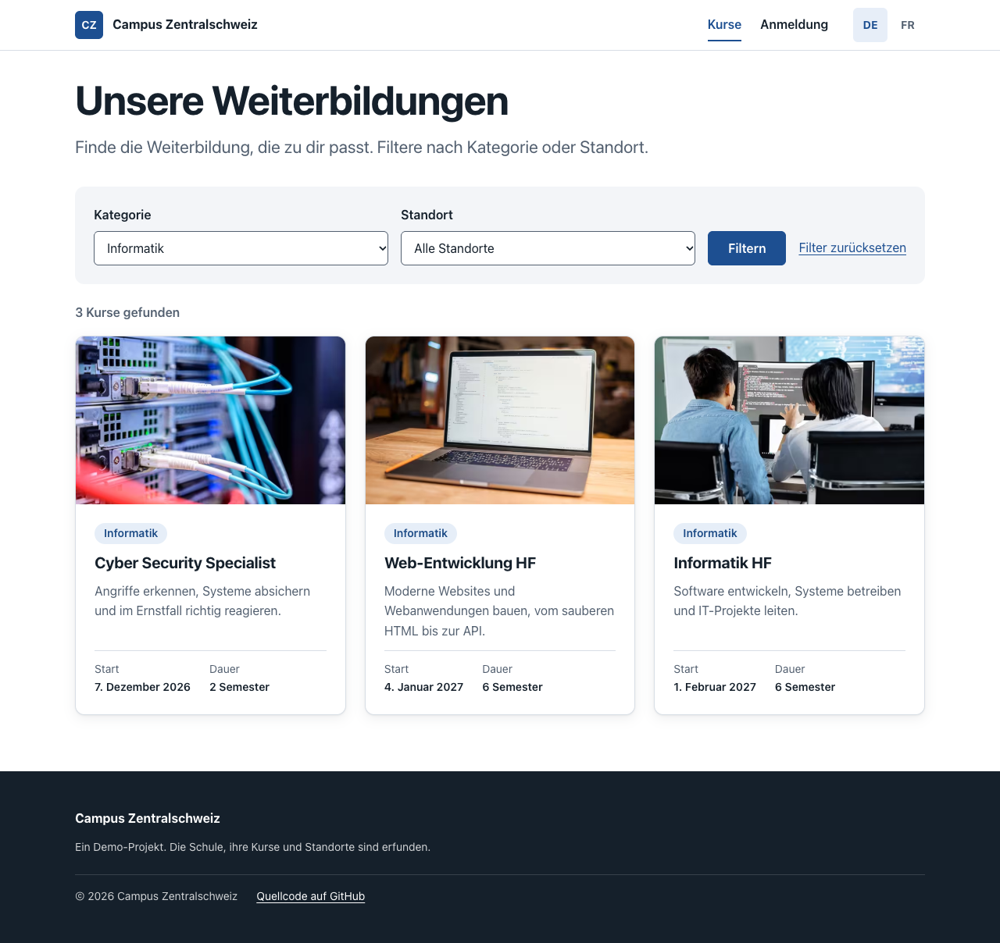
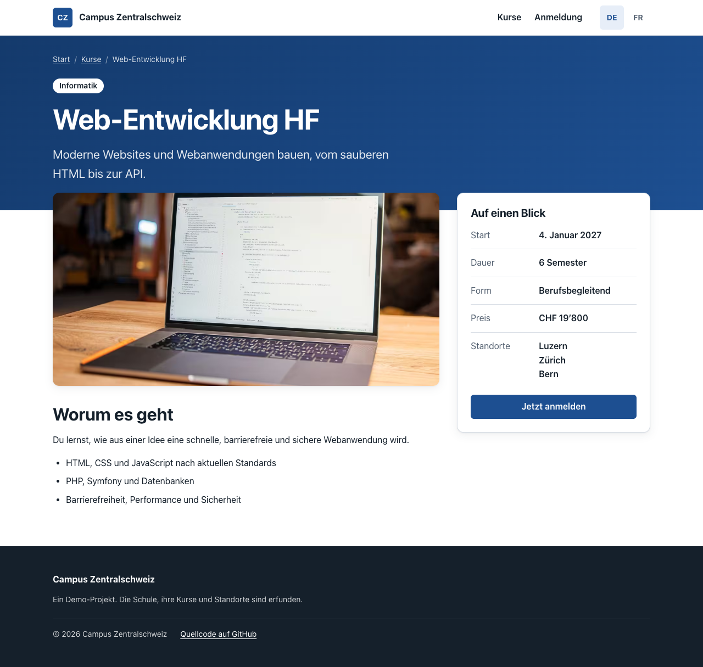
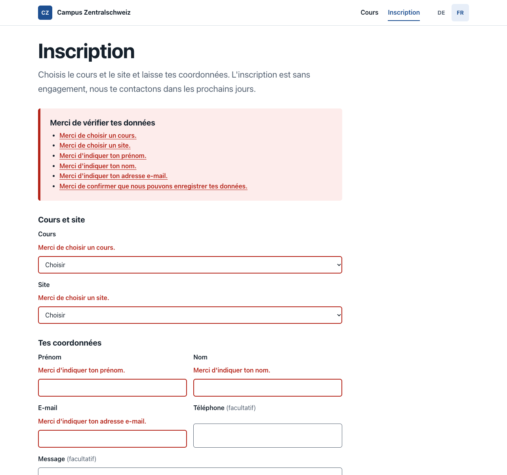
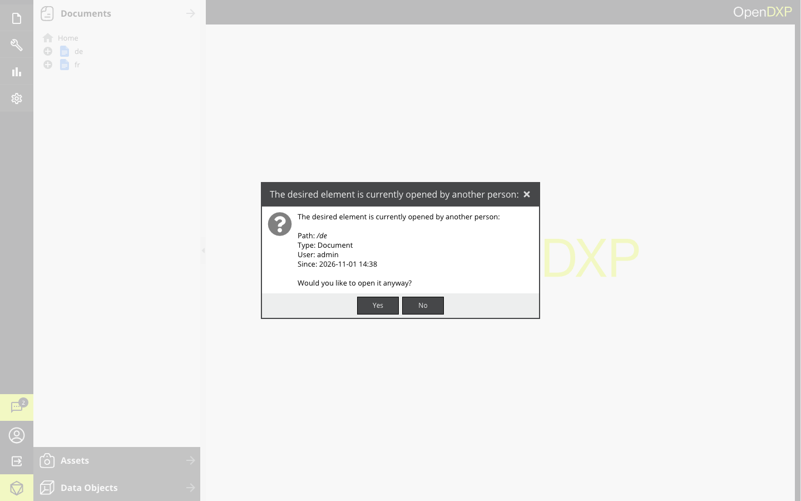
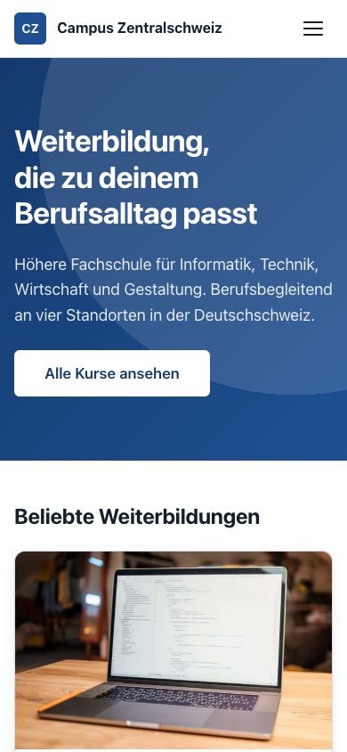

# Campus Zentralschweiz

[](https://github.com/arbnorhajdini/campus-pimcore/actions/workflows/ci.yml)

Eine kleine Demo-Kursplattform für eine fiktive Weiterbildungsschule mit vier Standorten, auf Deutsch und Französisch.
Gebaut mit OpenDXP (Pimcore), Symfony, Twig, SCSS und Vanilla JavaScript.



## Was das Projekt zeigt

- **Pimcore-Konzepte:** Data Objects mit übersetzbaren Feldern, Dokumente mit Editables, eine Startseite aus
  Areabricks, Thumbnails, Website-Einstellungen und Dokumente, die als Übersetzungen verknüpft sind.
- **Symfony:** Controller, übersetzte Routen, ein Formular mit Validierung, Services mit Dependency Injection.
- **Frontend:** Twig mit Layout-Vererbung, Partials und Macros, SCSS mit BEM und Design-Tokens, Mobile First,
  JavaScript als ES-Module ohne Bundler.
- **Barrierefreiheit:** semantisches HTML, Tastaturbedienung, sichtbarer Fokus, verknüpfte Fehlermeldungen.
- **Qualität:** Tests mit Pest, PHPStan, PHP-CS-Fixer und CI mit GitHub Actions. Mit `make setup` läuft das
  Projekt in wenigen Minuten, inklusive Demo-Inhalten.

| Kursübersicht mit Filter | Kursdetail |
| --- | --- |
|  |  |

| Anmeldung mit Fehlerübersicht (FR) | Startseite im Editmodus des Admins |
| --- | --- |
|  |  |

## Warum OpenDXP

OpenDXP ist der Open-Source-Fork von Pimcore 11 und steht weiter unter der GPLv3. Seit Version 2025.1 läuft
die Pimcore Community Edition unter der Pimcore Open Core License und braucht bei der Installation einen
registrierten Produkt-Key.

Für ein Demo-Projekt heißt das: Mit OpenDXP kann jeder das Projekt ohne Registrierung starten.
Die Konzepte sind dieselben wie in Pimcore (Documents, Data Objects, Assets, Editables, Areabricks, Twig).
Im Code heißen die Namespaces `OpenDxp\` statt `Pimcore\`.

## Schnellstart

Voraussetzungen: Docker mit Docker Compose (Docker Desktop, Colima oder OrbStack), `make` und ein freier Port 80.
PHP und Composer brauchst du nicht, alles läuft im Container.

```bash
git clone https://github.com/arbnorhajdini/campus-pimcore.git
cd campus-pimcore
make setup
```

`make setup` startet die Container, installiert die Pakete, richtet OpenDXP ein und legt die Demo-Inhalte an.
Das dauert beim ersten Mal einige Minuten.

| Was     | Adresse                  | Login             |
| ------- | ------------------------ | ----------------- |
| Website | <http://localhost>       |                   |
| Admin   | <http://localhost/admin> | `admin` / `admin` |

Der Login gilt nur für diese lokale Demo.

## Datenmodell

Die Klassen liegen als Definition in [`var/classes/`](var/classes) und werden bei der Installation angelegt.

| Klasse         | Felder                                                                                       |
| -------------- | -------------------------------------------------------------------------------------------- |
| `Location`     | Name, Ort, Adresse                                                                           |
| `Course`       | Titel, Kurzbeschreibung, Beschreibung (je DE/FR), Slug, Kategorie, Form, Dauer, Preis, Start, Bild, Standorte |
| `Registration` | Kurs, Standort, Vorname, Nachname, E-Mail, Telefon, Nachricht, Sprache                       |

Die Demo-Inhalte stehen in [`fixtures/demo.yaml`](fixtures/demo.yaml). `make demo` legt sie an oder aktualisiert sie.
Die Kursbilder sind generierte Farbverläufe, damit das Repo keine Fotos mit unklarer Lizenz enthält.

## Seiten

| Seite         | Deutsch                     | Französisch                 | Technik                                  |
| ------------- | --------------------------- | --------------------------- | ---------------------------------------- |
| Start         | `/de`                       | `/fr`                       | Dokument aus Areabricks                  |
| Kursübersicht | `/de/kurse`                 | `/fr/cours`                 | Dokument, Controller lädt die Kurse      |
| Kursdetail    | `/de/kurse/web-entwicklung` | `/fr/cours/web-entwicklung` | Symfony-Route mit einem Pfad pro Sprache |
| Anmeldung     | `/de/anmeldung`             | `/fr/inscription`           | Dokument mit Symfony-Formular            |

`/` leitet auf die Sprache weiter, die der Browser bevorzugt. Die Seiten beider Sprachen sind in OpenDXP als
Übersetzungen verknüpft, der Sprachumschalter führt deshalb immer auf dieselbe Seite in der anderen Sprache.

## Areabricks

Die Startseite besteht aus Bausteinen, die Redakteure im Admin hinzufügen, verschieben und bearbeiten.
Jede neue Seite, die ein Redakteur anlegt, nutzt dasselbe Template und dieselben Bausteine.
Jeder Brick ist eine Klasse in [`src/Document/Areabrick/`](src/Document/Areabrick) und ein Template in
[`templates/areas/`](templates/areas).

| Brick              | Inhalt                                                                         |
| ------------------ | ------------------------------------------------------------------------------ |
| Hero               | Titel (h1), Einleitung, Button mit Link-Editable                               |
| Kurse im Fokus     | Lädt in `action()` die Kurse mit dem Häkchen „Auf der Startseite hervorheben“  |
| Text mit Bild      | Überschrift, WYSIWYG-Text, Bild mit Thumbnail, Position links oder rechts      |
| Häufige Fragen     | Block mit beliebig vielen Fragen, als `<details>` ohne JavaScript aufklappbar   |

## Anmeldeformular

Ein Symfony-Formular ([`RegistrationType`](src/Form/RegistrationType.php)) mit den Regeln im Daten-Objekt
[`RegistrationData`](src/Registration/RegistrationData.php). Eine gültige Anmeldung wird als Data Object in
`/Anmeldungen` gespeichert, wo die Schule sie im Admin sieht.

- **Validierung auf dem Server**, mit verständlichen Meldungen in DE und FR. Eine eigene Regel prüft, ob der Kurs
  am gewählten Standort stattfindet.
- **Fehlerübersicht** oben im Formular, jeder Fehler ein Link zu seinem Feld. Sie bekommt nach dem Absenden den Fokus.
  Die Felder sind über `aria-describedby` mit ihrer Meldung verknüpft und tragen `aria-invalid`.
- **Optionale Felder sind markiert**, statt Pflichtfelder mit Sternchen zu versehen.
- **JavaScript als Verbesserung:** Nach der Kurswahl bietet das Standortfeld nur noch die Standorte dieses Kurses an.
  Ohne JavaScript funktioniert das Formular genauso, der Server prüft dann.
- **CSRF-Schutz**, Status 422 bei Fehlern und Redirect nach dem Speichern, damit ein Neuladen nichts doppelt sendet.
- Der Button „Jetzt anmelden“ auf der Kursseite wählt den Kurs im Formular schon aus.

## Frontend

```text
templates/
    layouts/base.html.twig      Grundgerüst: head, Skip-Link, Header, main, Footer
    partials/                   Header mit Navigation aus dem Dokumentbaum, Footer, Sprachumschalter
    components/                 Wiederverwendbare Teile wie die Kurskarte
    macros/format.html.twig     Datum und Preis im Format der Sprache
    areas/                      Die Templates der Areabricks
    form/theme.html.twig        Form-Theme mit BEM-Klassen
    pages/, course/, registration/  Die Seiten
assets/
    styles/                     SCSS: abstracts, base, layout, components, pages
    js/                         ES-Module ohne Bundler, über die Symfony AssetMapper
translations/                   Texte der Oberfläche in DE und FR (ICU, mit Plural)
```

- **Kein Node.js nötig.** Das SCSS kompiliert das Symfony Sass-Bundle im PHP-Container, JavaScript lädt als
  natives ES-Modul über eine Importmap.
- **SCSS:** BEM, eine Datei pro Komponente, Design-Tokens als CSS-Variablen, Breakpoints nur über ein Mixin.
- **Barrierefreiheit:** semantisches HTML, Skip-Link, sichtbarer Fokus, Labels an allen Formularfeldern,
  `aria-current` in Navigation und Sprachumschalter, ausreichende Kontraste.
- **Bilder:** OpenDXP erzeugt die Thumbnails als `<picture>` mit AVIF, WebP und JPEG, jeweils in 1x und 2x.
- **Ohne JavaScript benutzbar:** Der Kursfilter ist ein normales GET-Formular, jede Auswahl hat ihre eigene URL.
  Auf dem Handy bleibt das Menü ohne JavaScript offen, statt sich nicht mehr öffnen zu lassen.



## Befehle

| Befehl       | Was er macht                                       |
| ------------ | -------------------------------------------------- |
| `make setup` | Erster Start: Container, Pakete, Installation      |
| `make up`    | Container starten                                  |
| `make demo`  | Demo-Inhalte anlegen oder aktualisieren            |
| `make watch` | SCSS bei jeder Änderung neu kompilieren            |
| `make down`  | Container stoppen                                  |
| `make cache` | Caches leeren                                      |
| `make cs`    | Code-Stil korrigieren (PHP-CS-Fixer)               |
| `make stan`  | Statische Analyse (PHPStan)                        |
| `make test`  | Tests ausführen (Pest)                             |
| `make help`  | Alle Befehle anzeigen                              |

## Stack

| Bereich   | Technik                                              |
| --------- | ---------------------------------------------------- |
| CMS       | OpenDXP 1.5 (Pimcore-Fork) auf Symfony 7.4           |
| Backend   | PHP 8.3, MariaDB 10.11, Redis                        |
| Frontend  | Twig, HTML, SCSS, Vanilla JavaScript (ES-Module), Symfony AssetMapper |
| Qualität  | Pest, PHPStan, PHP-CS-Fixer, GitHub Actions          |
| Umgebung  | Docker Compose: PHP-FPM, Nginx, Supervisord          |

## Wie ich mit KI gearbeitet habe

Ich habe das Projekt mit Claude Code gebaut, deshalb steht Claude in den Commits als Co-Autor. Claude hat den
Großteil des Codes geschrieben. Ich habe die Richtung vorgegeben, die Entscheidungen getroffen und die Ergebnisse
geprüft. Den Output der KI behandle ich als Entwurf, nicht als fertige Lösung.

Was dabei in Reviews, im Browser und in den Tests aufgefallen ist und korrigiert wurde:

- **Lizenz:** Pimcore 2026 verlangt bei der Installation einen Produkt-Key. Deshalb OpenDXP, damit jeder das Projekt
  ohne Registrierung startet.
- **Secrets:** Das Skeleton schreibt einen Secret-Key in `services.yaml` und liefert eine Beispieldatei mit einem
  Google-Schlüssel mit. Beides ist vor dem ersten Push aus der Historie entfernt, das zweite hat die Push Protection
  von GitHub gemeldet.
- **Sprachumschalter:** OpenDXP hängt an Symfony-Routen das nächste Dokument als Fallback. Der Umschalter führte
  deshalb auf der Kursseite zur Kursübersicht statt zum Kurs in der anderen Sprache.
- **Eingaben:** `?location=luzern` führte zu einem Fehler 400, statt den Filter zu ignorieren.
- **Areabricks:** Der Hero ist auf einen pro Seite begrenzt, leere Bricks verschwinden, und weil das Link-Editable
  alle gespeicherten Daten als HTML-Attribute ausgibt, baut das Template den Link selbst.

## Was ich als Nächstes bauen würde

- Bestätigungs-E-Mail an die Interessierten und Benachrichtigung an die Schule
- Spamschutz für das Formular, zum Beispiel mit Honeypot und Symfony Rate Limiter
- Einen Bereich „Mein Campus“ mit Login und Rollen für Teilnehmende und Dozierende
- Übersetzte Ortsnamen (Lucerne, Zoug, Zurich, Berne)

## Lizenz

GPL-3.0, wie das [OpenDXP-Skeleton](https://github.com/open-dxp/skeleton), auf dem das Projekt aufbaut.
Siehe [LICENSE.md](LICENSE.md).
